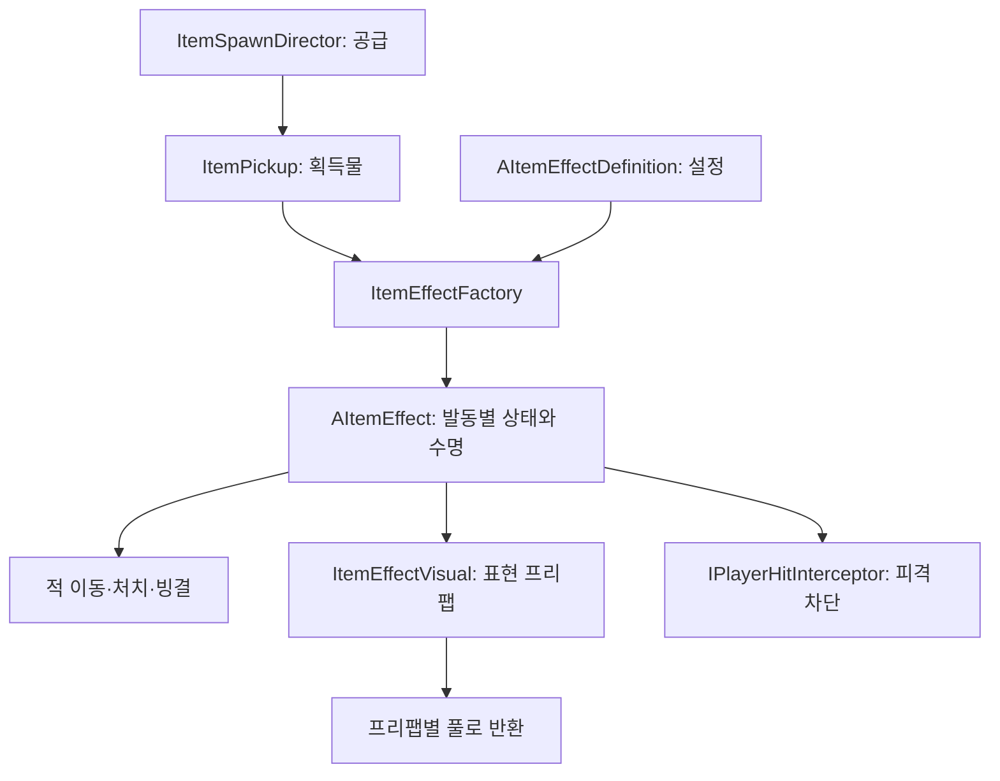

# 아이템 효과 구조

## 적용 범위

기존 폭탄·빙결 규칙에 플레이어 부착 효과와 피격 방어 효과의 확장 경로를 제공한다. 현재 MainPlay의 GameBalance 에셋에는 폭탄·빙결·보호막·유도 미사일 네 종류가 연결되어 있다. 보호막은 `ShieldEffectDefinition`과 `ShieldEffect`, `ShieldItemEffectVisual`로 구현했다. 유도 미사일은 `HomingMissileDefinition`, `HomingMissileEffect`, `HomingMissileVisual`을 사용한다. 가시의 실제 공급과 콘텐츠는 추가하지 않는다.

미사일이 필요한 적 ID·현재 위치·이동 구간 접촉 조회는 별도 `IHomingMissileTarget`으로 제공한다. 본편 적은 웨이브 활성화 시 ID를 발급받으므로 리스트 순서 변경이나 풀 재사용으로 표적을 잘못 이어받지 않는다. 기존 범위 처치 경로로 사망 연출과 점수를 처리한다. 효과 처리 순서는 폭탄 → 빙결 → 미사일 → 보호막이다.

## 처리 흐름

| 구분 | 보관하는 내용 | 생성 및 재사용 |
| --- | --- | --- |
| ItemData | 공급 종류·가중치, 효과 설정 참조 | GameBalance에서 공유 |
| AItemEffectDefinition | 특정 효과의 조정값, 생성 함수 | 설정 에셋을 공유하며 발동 상태는 저장하지 않음 |
| AItemEffect | 발동 중심, 소유자, 남은 횟수 등 발동별 상태 | 획득할 때 새 인스턴스 생성 |
| ItemEffectVisual | 이미지·애니메이션·파티클·자식 표현 | 같은 프리팹의 풀에서 재사용 |
| ItemSystem | 활성 목록, 공통 호출 순서, 풀 소유 | 한 판의 아이템을 관리 |

## 효과 로직

`AItemEffect`는 SpriteRenderer를 참조하지 않는다. `ItemEffectContext`를 통해 적에게 영향을 주거나 플레이어 Transform과 발동 위치를 읽는다.

- WORLD 앵커: 발동 위치가 유지된다. 현재 폭탄·빙결이 사용한다.
- PLAYER 앵커: 소유자 위치를 따라간다. 플레이어 Transform이 없어지면 효과를 종료한다.
- `Begin()`과 `OnBegan()`: 발동 시작. 파생 클래스의 초기 적용은 OnBegan 또는 Apply에서 결정한다.
- `Tick()`: 전투 시간에 맞춰 수명을 검사하고 소유자의 이전 위치를 기록한다.
- `Apply()`: 해당 틱의 효과를 적용하고 처치 수를 반환한다. 빙결 같은 단발 판정은 자체 플래그로 한 번만 적용한다.
- `Finish()`와 `OnFinished()`: 정상 만료·횟수 소모·재시작·관리 오브젝트 파괴 시 정리한다. Finish는 여러 번 호출되어도 정리 콜백은 한 번만 실행된다.

부착 공격은 `KillEnemiesInRange()`를 사용하면 효과와 적 양쪽의 이동 구간을 반영한다. 플레이어가 빠르게 움직여 현재 위치만으로는 지나친 적을 놓치는 문제를 피한다. 그 외 형상의 판정이 필요하면 해당 요구사항에 맞춰 적 대상 서비스를 추가한다.

사용자 정의 효과는 `AItemEffectDefinition.CreateEffect()`에서 생성한다. `ItemSystem`의 종류별 switch를 늘리지 않는다. ItemData의 기존 Radius/Duration/Visual Duration 필드는 기본 폭탄·빙결 호환값이며, 새 효과가 사용하지 않는 필드를 억지로 채울 필요는 없다. 새 효과의 전용 설정과 검증은 해당 Definition에 둔다. Definition은 GameBalance의 ItemData에서 참조한다.

## 피격 처리

전투 틱의 순서는 다음과 같다.

1. 기존 효과·획득물·빙결 만료와 적 이동을 처리한다.
2. 공급과 획득을 처리하고 효과를 시작한다.
3. 효과를 적용한다. 기존 폭탄이 빙결보다 먼저 적용되는 순서는 유지한다.
4. 남은 일반 적과의 접촉마다 `IPlayerHitInterceptor.TryBlockHit()`를 호출한다. 하나의 효과가 차단하면 다른 방어 효과는 그 접촉에 소모하지 않는다.
5. 차단하지 못한 일반 접촉이 있으면 사망한다. 사망하지 않은 경우 접촉한 빙결 적만 쇄빙한다. 방어로 막은 일반 적은 자동 처치·쇄빙하지 않는다.
6. 같은 틱의 처치 수를 합쳐 점수에 반영한 뒤 사망 결과를 확정한다.

`PlayerHit`는 플레이어 위치·접촉 적 위치·현재 전투 시간을 전달한다. 한 번 방어인지 일정 시간 방어인지, 몇 접촉을 막는지는 실제 방어 효과가 결정한다. 이 인터페이스에서는 적 목록을 직접 변경하지 않는다. 공격이나 반격 처치는 Apply 단계에서 처리해야 점수 집계와 적 순회가 일관된다.

## 표현과 풀

새 효과의 ItemVisual에는 Effect Prefab을 지정한다. 프리팹 루트에 ItemEffectVisual을 추가하면 자식 SpriteRenderer, Animator, ParticleSystem 등 여러 오브젝트로 표현할 수 있다. ItemEffectVisual 파생 클래스의 콜백으로 회전하는 가시 등 전용 표현을 구현할 수 있다.

- 같은 프리팹은 같은 풀에서, 서로 다른 프리팹은 서로 다른 풀에서 재사용한다.
- 표현의 위치는 효과의 앵커를 따른다. 실제 플레이어 자식으로 붙이지 않아도 플레이어를 따라간다.
- 재사용 시작 시 Animator를 초기화하고 파티클을 비운 뒤 재생한다.
- 종료 시 파티클을 비우고 비활성화하며, 루트 회전·크기를 초기값으로 복구한다.
- 파생 표현이 변경한 자식 상태는 OnEffectStopped에서 직접 정리한다. 발동 시작 설정은 OnEffectBegan을 사용한다.
- 프리팹의 Collider나 애니메이션 이벤트가 자동으로 전투 판정을 수행하는 것은 아니다. 판정과 점수는 효과 로직에서 관리한다.

기존 SpriteRenderer/프레임 연결은 SpriteItemEffectVisual이 처리한다. 기존 BombItem 컴포넌트, 스크립트 GUID와 씬 연결은 유지한다. 기존 폭탄·빙결을 새 프리팹으로 교체할 필요는 없다.

## 새 아이템 구현 순서

1. 실제 규칙과 수치, 연속 획득 시 중첩·갱신 정책을 확정한다.
2. AItemEffectDefinition 파생 클래스를 만들고 전용 값과 Validate, CreateEffect를 구현한다. 소유자가 필요한 효과는 RequiresOwner를 true로 지정한다.
3. AItemEffect 파생 클래스에서 앵커, 수명, Apply와 필요한 종료 정리를 구현한다. 방어 효과에는 IPlayerHitInterceptor를 추가한다.
4. 표현 프리팹을 제작하고 루트에 ItemEffectVisual 또는 파생 컴포넌트를 붙인다.
5. GameBalance.Items에 해당 종류·가중치·Effect Definition을, ItemVisuals에는 아이콘·Effect Prefab을 연결한다.
6. 만료·소모·중첩·동시 접촉·재시작을 검증한다.

현재 SHIELD는 실제 Bubble Shield 효과로 공급한다. 무한 장착 상태에서 일반 적의 버블 접촉을 발견하면 고정 위치의 유한 폭발로 전환한다. `IItemContactTarget`이 최초 접촉 위치를 제공하며, 방어 콜백에서 적 목록을 변경하지 않고 Apply 단계에서 폭발 처치를 집계한다. `CanBeReplaced`를 사용해 장착 버블은 교체하고 이미 발생한 폭발은 보존한다. SPIKES는 식별자와 확장 경로만 남겨 두었으며 실제 공급에는 포함하지 않는다.

## 검증

Unity 6000.3.20f1의 격리된 임시 프로젝트에서 기존 회귀 검사 20개와 구조 검사 12개, 총 32개를 통과했다. 구조 검사에는 고정·플레이어 앵커, 이동 구간 공격, 접촉별 방어와 소모, 동시 획득 상태 분리, 빙결 접촉 시 방어 미소모, 만료, 재시작, 프리팹별 풀 재사용, 소유자 소멸, 실제 Play Mode의 관리 오브젝트 파괴 콜백을 포함한다.

실제 MainPlay와 기기에서의 조작·시각 품질 및 보호막·가시의 최종 규칙 검증은 별도다.
